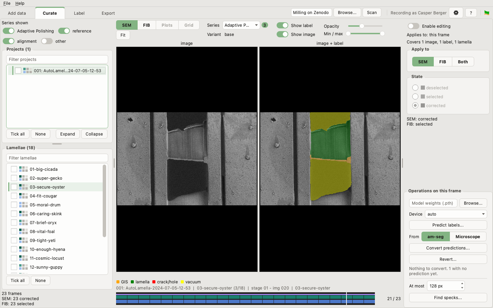

AM segmentation manager
=======================

Curate, proofread and export the segmentation labels of FIB/SEM images from
Autolamella's adaptive milling.

A collection of Autolamella data soon holds thousands of images, their labels,
the predictions of several models, and metadata spread over image headers and
project files. AM segmentation manager answers the questions that get hard once
it outgrows a spreadsheet: which images are worth labelling, which labels have
been proofread, what the labels contain, and which subset should go into a
training run or a public data deposit.

What it does
------------

* **Reads the data you already have.** Every Autolamella layout back to 2023,
  and datasets from before Autolamella, are read as they are: nothing on disk
  is moved to fit a newer convention.
* **Curates, a lamella at a time.** Look through each lamella's frames beside
  their labels, on the grid it was milled from, and mark each label group
  selected, deselected or corrected.
* **Predicts and proofreads.** Run a trained model, turn its predictions into
  labels, and correct them at full resolution with a brush, a fill and a
  finder for specks too small to be real.
* **Exports what you choose.** Filter and count a subset, measure what its
  labels hold, and write training lists, metadata for a deposit, or a copy of
  the files that merges back later.
* **Keeps the files as the truth.** There is no database. Everything am-seg
  knows is in files beside your data, which you can read yourself.
* **Is careful with proofread work.** No automated operation overwrites a
  corrected label, every batch is checked whole before any of it is written,
  and every change is recorded, with the label it replaced kept.

Installation
------------

From a source checkout, with [uv](https://docs.astral.sh/uv/). One command on
Windows, macOS and Linux, and it installs Python itself:

    uv sync --extra gui               # the window, the command line and charts
    uv sync --extra gui --extra ml    # ... and predicting

This builds `.venv` inside the checkout from `uv.lock`, so every machine gets
the versions the tests were run against. Run anything in it with `uv run`:

    uv run am-seg gui

**`uv sync` installs exactly the extras it is given** and removes the rest, so
name every extra you want each time. The extras combine freely, `ml` and
`ml-cuda13` apart:

| Extra | Adds |
|---|---|
| `gui` | the window, the image stack and charts |
| `ml` | predicting: torch and the model libraries, several gigabytes |
| `ml-cuda13` | predicting, with torch for CUDA 13, for a card the default build has no kernels for, such as a 50-series |
| `all` | the image stack and charts, for the command line without the window |
| `plots` | charts alone, for the command line's plots |

Windows and Linux get torch built for CUDA 12.6, which runs on any NVIDIA
driver from 525; Apple silicon predicts on its own GPU. To see what this
environment can do:

    uv run python scripts/check_environment.py

With pip instead, into an environment of its own:

    pip install -e '.[gui,ml]'

pip ignores `uv.lock` and takes whichever versions are newest.

**On Windows, turn on long paths.** Windows reaches a path of 260 characters or
more only with its long-path setting on, and the label versions am-seg keeps
under `AM_archive/` run long: a collection under `C:\Users\<you>\` or OneDrive
can pass the limit. Without it, saving, converting and exporting refuse the
whole batch rather than failing partway. Turn it on once, in PowerShell run as
administrator, then restart am-seg (and Windows, if am-seg still cannot reach
them):

    New-ItemProperty -Path "HKLM:\SYSTEM\CurrentControlSet\Control\FileSystem" -Name "LongPathsEnabled" -Value 1 -PropertyType DWORD -Force

On a managed machine, ask IT for the Group Policy *Enable Win32 long paths*.
`scripts/check_environment.py` says whether long paths work.

**On Linux, the window needs the system library `libxcb-cursor0`.** Ubuntu's
desktop install has it; a server or a minimal install may not, and adding it
takes an administrator: `sudo apt install libxcb-cursor0`.
`scripts/check_environment.py` says whether the window can open, and
[Troubleshooting](guides/07_troubleshooting.md) has a way round it without one.

If something will not install or start, see
[Troubleshooting](guides/07_troubleshooting.md).

Uninstalling
------------

Three steps remove everything am-seg put on this computer outside your data:

1. Take the launchers away, from the install they were made with:

       uv run am-seg create-shortcut --remove

   On Windows, a taskbar pin is Windows' own copy: unpin it by hand.
2. Delete the checkout, which holds the environment in `.venv`; or, after a pip
   install, `pip uninstall adaptive-milling-seg`.
3. Delete `~/.am_segmentation_manager` (`%USERPROFILE%\.am_segmentation_manager`
   on Windows): the window's log, and the name your changes are recorded under.
   Every install on this computer shares it, so keep it while another remains.

uv keeps the packages it downloaded, torch among them, for any project to reuse;
`uv cache clean` frees that space. Your collections keep the files am-seg wrote
beside the data, [listed in the user guide](guides/01_concepts.md#what-am-seg-writes):
they are part of the data, not of the install.

Getting started
---------------

    am-seg create-shortcut            # once: start the window like any other application
    am-seg gui <folder>               # the window, on a folder of your data
    am-seg inspect-layout <folder>    # read-only: how is this folder read?

From a checkout, put `uv run` in front of each. `create-shortcut` adds the
window to the Applications folder on macOS, the applications menu on Linux, and
the Start menu and Desktop on Windows; the window's File menu offers the same.

The window has a tab for each phase of the work:

| Tab | For |
|---|---|
| **Add data** | naming which folders are projects, and describing them |
| **Curate** | looking through the frames, setting their state, predicting and converting labels |
| **Label** | proofreading one lamella's labels at full resolution |
| **Export** | choosing a subset, counting and measuring it, and writing it out |

Nothing on Curate writes until *Enable editing* is switched on. **F1** lists the
keys and gestures of the tab you are on.

Documentation
-------------

[The user guide](guides/README.md) explains the concepts, each tab, the history
am-seg keeps, and what to do when something goes wrong, with pictures of the
window. `am-seg --help` lists every command, and `am-seg <command> --help`
explains one.

The command line does everything the window does, and holds the reports on a
whole collection:

| To do this | Run |
| --- | --- |
| See how a folder is interpreted | `inspect-layout` |
| Make a pre-Autolamella dataset indexable | `init-project` |
| Read or edit project metadata | `show-metadata` / `edit-metadata` |
| Scan a directory and list the projects found | `list-projects` |
| Predict labels with a trained model | `predict` |
| Turn predictions into labels for proofreading | `convert-predictions` |
| Choose what gets proofread | `deselect` / `select` / `correct` |
| Find stray spots and holes likely to be too small to be real | `find-specks` |
| Shrink label files on disk | `compress-labels` |
| Count images by one or two properties, and chart them | `stats` |
| Measure what the labels contain, in um^2 | `quantify-labels` |
| Export metadata and training lists | `export-*-csv` / `create-training-csv` |
| Export a selection of images and labels into a folder of its own, ready to merge back | `export-files` |
| Check an exported CSV still resolves | `check-training-csv` |
| Record the history of a collection already holding work, all at once | `init-history` |
| Name the state of the data, so a round of work can be undone | `savepoint` |
| See the savepoints here, what each covers and what it still reaches | `list-savepoints` |
| Read what has been recorded about a project or a label | `history` |
| Merge a worked-on copy back into the collection | `merge` |
| Put labels back to what they held before a conversion or a merge | `revert` |
| See the label versions a project has kept | `archive` |
| Remove surplus kept versions | `prune-archive` |
| Add the window to this computer's applications, or take it away again | `create-shortcut` |

[`CHANGELOG.md`](CHANGELOG.md) says what each release changed.

Models and data
---------------

The models Adaptive Milling was trained with, and the data they were trained
on, are published on Zenodo:
[doi:10.5281/zenodo.21804785](https://doi.org/10.5281/zenodo.21804785). The
pictures in the user guide are of two of its projects.

Contributing
------------

[`CONTRIBUTING.md`](CONTRIBUTING.md) says how the package is laid out, how to
run the tests, and where the reasons behind it are written down.

Maintainer and status
---------------------

Written and maintained by Casper Berger (casper.berger@rfi.ac.uk) at the
Rosalind Franklin Institute. Questions, bugs, and layouts that are not read
correctly are welcome by email — the project is not yet hosted, so there is no
issue tracker.

**Status: in development, and not yet licensed for redistribution.** The
package carries no `LICENSE`, which means default copyright — all rights
reserved — while the licensing question is open. It is intended to be open
source in future.
