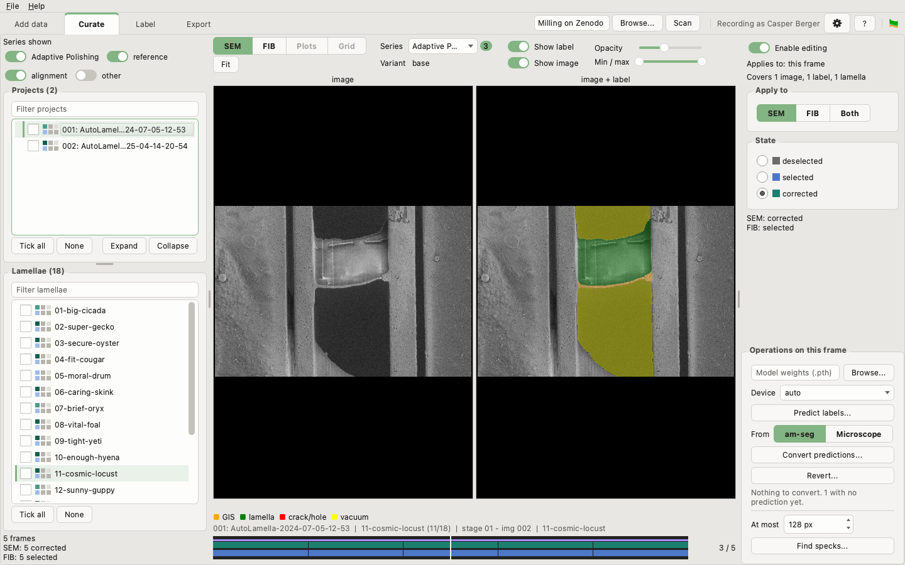

# Curate

Go through the images a lamella at a time, decide which are worth labelling,
and predict and convert labels for them. Proofreading those labels is the
[Label](04_label.md) tab's job; this one is where you choose what gets
proofread.

The tab has three columns: what to look at on the left, the frame in the
middle, and what to do to it on the right.

## Choose what to look at

**Series shown**, at the top left, decides which series the lists cover:
Adaptive Polishing, reference, alignment and *other*. *Other* starts switched
off; the lamella list says how many images it is leaving out.

Below it are the **projects** the scan found and the **lamellae** of the one
chosen. Click a row to look at it; type in the box above a list to filter it.
The chip beside each row shows how far curation has got, with one square for
each series switched on, SEM above and FIB below. A square says one of five
things: there are no images of that series; there are images, and nobody labels
that series; nothing is corrected yet; part is corrected; or everything is
corrected, or deselected as not wanted. **F1** shows what each looks like.

## Look at a frame

A **frame** is one acquisition: its SEM and FIB images, taken together. The
middle column shows the frame on screen twice, the image alone and the image
under its label, so you can judge the label against what it covers.

Along the top:

- **SEM** and **FIB** choose the beam (keys **1** and **2**).
- **Plots** shows the summary figure an alignment run saved, and **Grid** the
  project's grid overview with every lamella marked on it (keys **3** and
  **4**). Each is greyed out where the project has none.
- **Series** chooses which series the timeline is made of, and **Variant**
  which imaging condition, where a frame was imaged under several. A frame
  opens on its family's primary condition, and one not imaged under the
  condition chosen shows another of the same family.
- **Show label**, **Show image**, **Opacity** and **Min / max** change how the
  frame is drawn, and nothing else.

The **Grid** view is the one that is not of the frame: it shows where on the
grid the lamella is. Every lamella of the project is ringed, and the one you
are looking at is named. Where a project has several overviews, **Overview**
chooses between them, and a note under the picture says when the positions
are approximate.

Under the frame, the class legend names the colours, and a line of text names
the project, lamella and image. A note above the legend says when what you see
is not the whole story: no label, an empty one the segmentation software wrote,
or one resized to fit.

### The timeline

The strip at the bottom is the lamella's frames in order, SEM above and FIB
below. Each column is coloured by its state, and a thin line under it shows its
label: annotated, an empty file, or none.

| Colour | State |
|---|---|
| grey | deselected: no label is wanted here |
| blue | selected: a label is wanted and not yet finished |
| green | corrected: the label has been proofread |

Click or drag along it to move; **Left** and **Right** step a frame, **Up** and
**Down** a lamella.

## Change a state

The right-hand column changes the state of label groups. It waits for
**Enable editing**, at its top.

1. **Choose what to change.** With nothing else chosen, a change applies to the
   frame on screen. To change more, either tick projects or lamellae in the
   lists, or pick frames out on the timeline: **Ctrl-click** a frame, or
   **Shift-click** to extend a run; **Esc** drops them. Only one of these is
   used at a time, so what is ticked on screen is the whole of what will change.
   *Applies to* and *Covers*, at the top of the column, say how much that is.
2. **Choose the beam** under *Apply to*: SEM, FIB or both.
3. **Choose the state**, or press **D**, **S** or **C**.

The change is written at once to the stage's `AM_state.yaml`, after a
question where more is at stake:

- changing more than the frame on screen asks first, counting every image the
  change reaches, since images sharing a label move with it;
- marking a group corrected that has no label, or an empty one, asks first;
- taking a group out of *corrected* asks first.

Under the state buttons, *SEM:* and *FIB:* show the state of the frame on
screen for each beam.

## Predict and convert

*Operations on this frame*, at the bottom right, act on the same choice as the
state buttons: the ticked rows, the frames picked out, or the frame on screen.
Each one that writes shows what it would do before doing it, and waits for
*Enable editing* too. Predicting needs the `ml` extra installed.

**Predict labels...** runs a trained model over the chosen images.

- Name the model's weights file in the box above, or **Browse...** for it. The
  window remembers one model for each series and beam.
- **Device** chooses where it runs: `auto` takes the GPU with most memory free,
  or names one; `cpu` always works, slowly.
- A model predicts one beam, so a choice covering both SEM and FIB images is
  refused. One prediction is made per label group, from its primary condition
  (see [Add data](02_add_data.md#correct-the-families)), and an image this model has
  already predicted is passed over, so a run stopped halfway can be started
  again.
- Predictions go in the image folder's `_predictions` folder, never into a label.

The models Adaptive Milling was trained with are published on Zenodo
([doi:10.5281/zenodo.21804785](https://doi.org/10.5281/zenodo.21804785)).
`AM_SEM_All_V01.pth` is the one trained on all the data.

**Convert predictions...** turns each prediction into a label, ready to
proofread. **From** chooses whose predictions to use where an image has both:
*am-seg*'s, or the *Microscope*'s, which Autolamella made while milling. The line
under the button says what converting would find. Replacing a label that holds
annotation has to be confirmed, and a corrected label is never replaced.

**Revert...** puts the chosen labels back to what they held before the last
conversion or merge, or at a savepoint. A label with no kept version, or edited
since, is reported and left alone.

## Find specks

**Find specks...** reads every label in the choice and reports the ones holding
pieces too small to be likely real: a stray brush stroke, or a pinhole in a
class. **At most** sets how small, in pixels. Some are genuine, so it changes
nothing; open the lamella on the [Label](04_label.md#find-specks) tab to look
at each one.

## From the command line

| To | Run |
|---|---|
| change states | `am-seg select`, `deselect`, `correct` |
| predict | `am-seg predict --model <weights.pth> --modality SEM ...` |
| convert | `am-seg convert-predictions --modality SEM ...` |
| find specks | `am-seg find-specks ...` |

Each takes the options in [The command line](08_command_line.md#pointing-a-command-at-part-of-a-collection)
to choose which images, and each that writes takes `--dry-run` to say what it
would do first.
