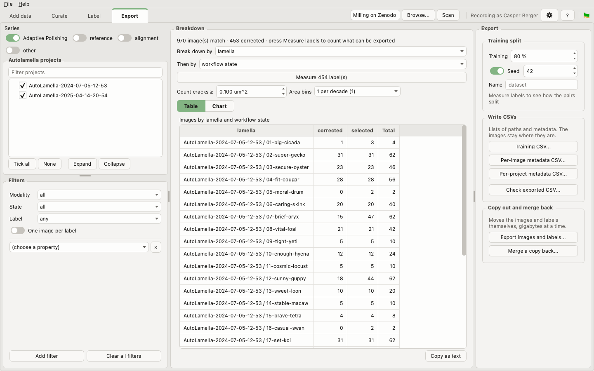
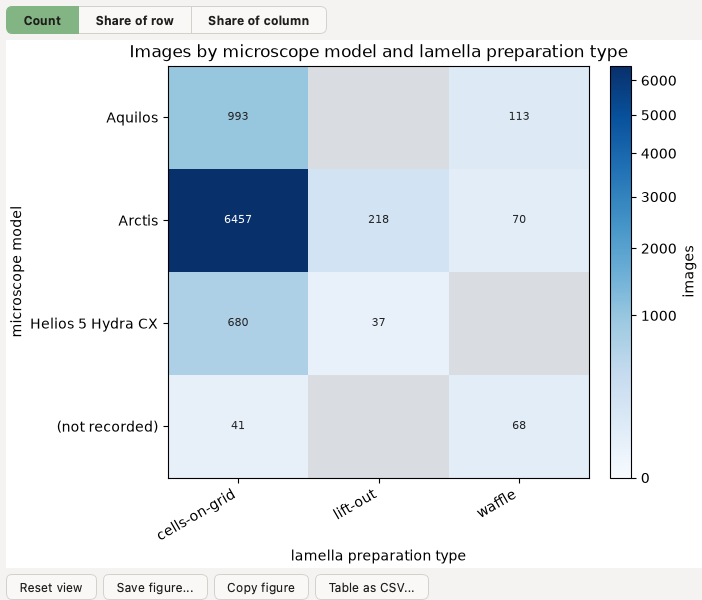

# Export

Choose a subset of the collection, see what it holds, and write it out: lists
of images and labels to train a model on, metadata for a public deposit, or the
files themselves, copied into a folder of their own.

The tab is three boxes with three jobs. **Filters**, on the left, decides which
images are in play. **Breakdown**, in the middle, counts them. **Export**, on the
right, writes them out. Nothing on the right narrows anything, so the count in
the middle is always what an export would cover.

## Choose the images

The tab opens on the whole collection, and every control narrows it:

- **Series** switches which series are counted. It opens on Adaptive Polishing
  alone, as the commands do.
- **Projects**, ticked or not.
- **Modality**, **State** and **Label**. *Label* chooses by what the label file
  holds: *annotated*, *empty*, *has a label*, or *no label yet*.
- **One image per label** keeps one image of each label group rather than every
  imaging condition, where several share a label.
- **Add filter** adds a filter on any other property: the microscope, the beam
  current, the sample, a milling task, and so on. Tick the values to keep;
  ticking none keeps them all. **Clear all filters** unticks every value and
  leaves the filters in place.

State starts on *all*, so an image somebody decided against can reach an
export. The line at the top of *Breakdown* says when one would.

## Count them

**Break down by** counts the images the filters keep by one property, and
**Then by** against a second. Any property a filter can use is here too, and a
few more that have too many values to filter on, such as the stage.

An image with several values of one property, such as two samples, is counted
under each. The rows then add to more than the images, and the table says so.

**Table** shows the counts as numbers, and **Copy as text** copies them. **Chart**
draws them, with buttons to pan, zoom, save or copy the figure, and export the
table as a CSV. A chart of two properties is a grid, shaded by count or by
share of its row or column:

### What the labels hold

Opening every label is slow, so the tab does not until asked. **Measure
labels** reads every label the filters keep, once, and adds breakdowns of what
they hold: how much of each class, in µm², and how many cracks. **Count cracks
≥** sets how large a piece of the crack class must be to count, and **Area
bins** how finely areas are grouped. Changing either reads nothing again.
`am-seg quantify-labels` measures the same, per lamella, and writes a CSV
with `-o`; it measures corrected labels unless told otherwise, since a label
made from a prediction measures the model rather than the sample.

## Write it out

### A training set

*Training split* and **Training CSV...** write the images the filters keep as
lists of image and label paths, for training a model:

- `<name>_train.csv` and `<name>_val.csv`, split by **Training**, 80 % by
  default; at 100 % there is no validation file.
- **Keep together** says what is never divided between the two: each
  **Lamella** by default, each **Project**, or only each **Acquisition**.
  Successive images of one lamella are near-duplicates, so a finer split
  scores a model on lamellae it was trained on. The imaging conditions and
  both beams of one acquisition stay together whichever is chosen. The line
  under the settings says how many groups were kept whole; the larger they
  are, the further the split can land from the share asked for.
- With **Seed** on, the same selection always splits the same way; switch it
  off to shuffle differently each time.
- `<name>_manifest.yaml` beside them records what they were made from, and
  what was kept together.

A training set exported before *Keep together* existed kept only
acquisitions together. Choose **Acquisition** and the seed its manifest
records to make the same files again.

With one beam chosen, each row is an image and its label. With both, each row
is one acquisition, with its SEM and FIB images and labels side by side.

**An empty label is never exported.** A row survives only if a label holds
annotation; a label that will not open is left out too, and counted in the
manifest. Measure the labels first to see how many pairs each side of the split
will get.

**Check exported CSV...** reads a CSV written earlier and reports any path in it
that no longer points at a file.

### Metadata for a deposit

- **Per-image metadata CSV...** writes one row per image: its project, lamella,
  series and task, the project's metadata, and what the image header recorded
  about the microscope and the beam.
- **Per-project metadata CSV...** writes one row per project, with its metadata
  and how many images it holds.

### The files themselves

**Export images and labels...** copies the images the filters keep, their
labels, and each project's own files into a folder, keeping the layout, so the
copy is a collection of its own. Nothing there is overwritten, and a copy
stopped halfway carries on where it left off when run again. It checks first
that there is room for it, and refuses a destination inside the folder it is
copying from.

The copy remembers where it came from. Work done on it, on another computer
say, comes home with **Merge a copy back...**, which needs *Enable editing* on
the Curate tab. Nothing is merged while a conflict stands, and a corrected label
here is never written over unless you choose it.

## Nothing is replaced unasked

Every file an export would write is checked before anything is read. One
already there is replaced only once you say so: a training split written over
by accident is gone, with the seed that made it.

## From the command line

| To | Run |
|---|---|
| count images, and chart them | `am-seg stats` |
| measure the labels | `am-seg quantify-labels` |
| write a training set | `am-seg create-training-csv --state corrected ...` |
| write per-image or per-project metadata | `am-seg export-metadata-csv`, `export-projects-csv` |
| copy images and labels out | `am-seg export-files` |
| check a CSV still resolves | `am-seg check-training-csv` |
| merge a copy back | `am-seg merge <copy> --into <collection>` |
