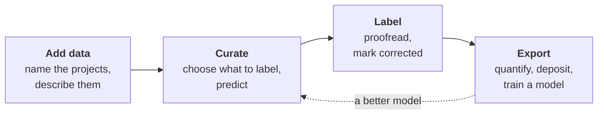

# User guide

How to use AM segmentation manager: the window, which is where the work is
done, and the `am-seg` command line beside it. Installing it is in the
[README](../README.md#installation).

The work runs in four phases, and the window has a tab for each:

## Chapters

1. [Concepts](01_concepts.md): projects, series, label groups and their three
   states, and every file am-seg writes.
2. [Add data](02_add_data.md): opening a folder, naming its projects, and
   describing them.
3. [The command line](08_command_line.md): every command, and how to point one
   at part of a collection.
4. [Keys and gestures](09_keys.md): everything F1 lists, for every tab.

The chapters on curating, proofreading, exporting and history are being
written. Until they are, the [README](../README.md) describes each tab.
