# User guide

This guide takes you through am-seg in the order you will use it: from a folder
of Autolamella projects to proofread labels, an exported training set and a model trained on it. It
shows where things are rather than explaining every option. In the window:

- **Hover over a control** to see what it does.
- **Press F1** to list the keys of the tab you are on, and what its coloured
  marks mean.
- **The scroll wheel never changes a setting.** Over a number, a dropdown or a
  slider it scrolls the page behind; click the control, then type or use the
  arrow keys.

Installing am-seg is described in the [README](../README.md#installation).
[Background](background.md) explains how am-seg reads your data and keeps its
history, and [the command line](command_line.md) and
[troubleshooting](troubleshooting.md) have guides of their own.

## 1. Put your projects in one folder

am-seg works on a **collection**: one folder holding your Autolamella projects.
The projects can sit directly in it, or in folders of their own inside it, for
example one per session:

```text
Autolamella data/
├── 20240705_adaptive_milling/
│   ├── AutoLamella-2024-07-05-10-55/
│   └── AutoLamella-2024-07-05-12-53/
└── 20250414_adaptive_milling/
    └── AutoLamella-2025-04-14-20-54/
```

Leave each project as Autolamella wrote it. am-seg reads every Autolamella
layout since 2023 as it is, without reorganising anything. Datasets
from before Autolamella can go in the same folder; step 3 shows how to add them.

## 2. Scan the folder

When am-seg starts, it asks for a folder:

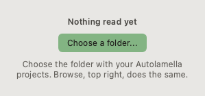

Choose your collection. am-seg finds every project in it and lists them under
the folders they sit in. The first scan of a large collection takes a while,
as it reads the header of every image.

Later on, choose another folder with **Browse...** (1), and press **Scan** (2)
to read the folder again after something outside am-seg has changed it:

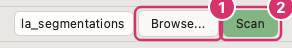

**Set your name** with the gear button beside them. am-seg records who made each
change, and until you set a name it records none.

## 3. Add data

The **Add data** tab is where you add projects and describe them.

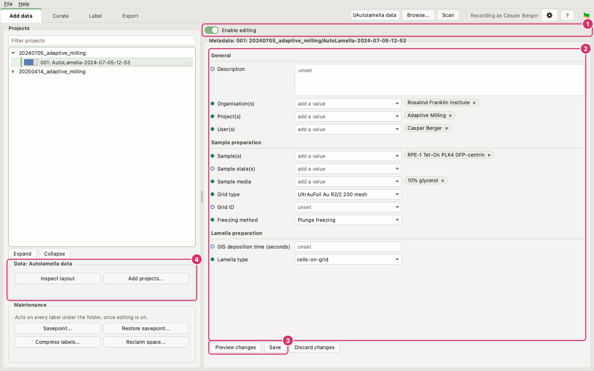

### Add projects that are not from Autolamella

Projects with an Autolamella `experiment.yaml` appear on their own. A dataset
from before Autolamella has to be added by hand. The *Data* card (4) says how
many folders hold images that no project covers.

1. Switch on **Enable editing** (1).
2. Press **Add projects...** in the *Data* card (4). The dialog proposes the
   folders that could become projects.
3. Tick the ones you want and press **Write metadata files**. Where a folder
   holds several datasets, select it and press **Look inside** to choose the
   folders below it instead.

Each project you add gets an `AM_metadata.yaml` file, which is what makes it a
project. If a folder is not read the way you expect, see
[Troubleshooting](troubleshooting.md#a-folder-is-not-read-as-expected).

### Describe your projects

The description travels with every export, so it is what a deposit or a
training set says about where the data came from.

1. Click a project in the list. To describe several at once, click the folder
   they are in: fields the projects disagree on show as *mixed*, and are left
   alone unless you change them.
2. Switch on **Enable editing** (1) and fill in the fields (2). As you type, a
   field suggests the values other projects already use, which keeps spellings
   consistent: `foil` finds both `Quantifoil` and `UltrAuFoil`.
3. Press **Preview changes** to see what will be written, then **Save** (3).

The bar beside each project in the list shows how complete its description is.
Hover over a field for what to enter; the same guidance is below.

<!-- generated: fields -->

**General**

| Field | What to enter | Takes |
|---|---|---|
| Description | What this experiment was for | text |
| Organisation(s) | Organisation that acquired the data | text, one or several |
| Project(s) | Name of the wider project this belongs to | text, one or several |
| User(s) | Who acquired the data | text, one or several |

**Sample preparation**

| Field | What to enter | Takes |
|---|---|---|
| Sample(s) | Cell type or organism | text, one or several |
| Sample state(s) | What was done to the sample, e.g. infected, differentiated | text, one or several |
| Sample media | What the sample was in, e.g. culture medium, cryoprotectant, fiducials | text, one or several |
| Grid type | Grid the sample was prepared on, e.g. Quantifoil R2/2 Cu 200 mesh | text |
| Grid ID | Identifier of the physical grid this was prepared on | text |
| Freezing method | How the sample was vitrified | text; usually Plunge freezing or High pressure freezing |

**Lamella preparation**

| Field | What to enter | Takes |
|---|---|---|
| GIS deposition time (seconds) | Seconds of GIS deposition, as a number | a number |
| Lamella type | One of: cells-on-grid, waffle, lift-out, other | one of: cells-on-grid, waffle, lift-out, other |

<!-- end generated -->

am-seg writes only to `AM_metadata.yaml`. Autolamella's `experiment.yaml` is
never changed: a value you enter here takes the place of the same field in it.

## 4. Curate

The **Curate** tab is where you look through your data, decide which images
are worth labelling, and predict labels for them.

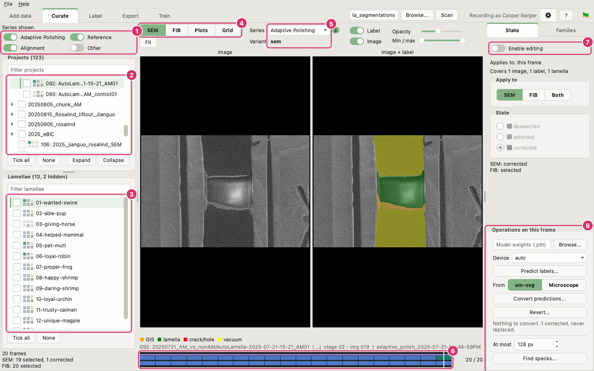

### Look through your data

1. **Series shown** chooses which images the lists cover: the Adaptive
   Polishing images, the reference and alignment images Autolamella takes
   around each milling task, and *other*, everything else.
2. **Projects**: click one to list its lamellae, or click a folder to list
   every lamella in it.
3. **Lamellae**: click one to show it. The chip beside each row shows how far
   its curation has got.
4. **SEM** and **FIB** switch between the two beams. **Plots** shows the figure
   an alignment run saved, and **Grid** the grid overview with every lamella
   ringed:

   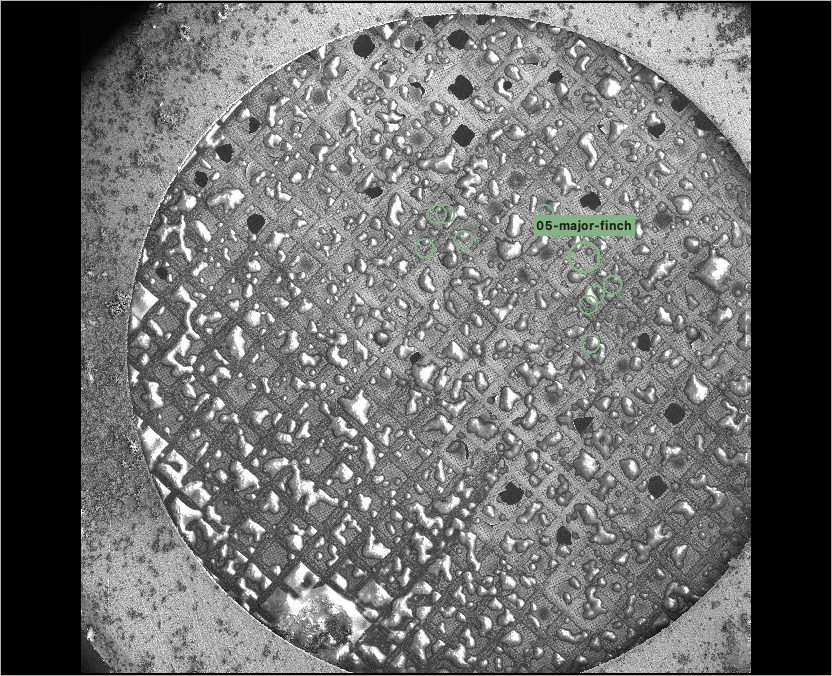

5. **Series** chooses which images the timeline steps through. Where a frame was
   imaged under several conditions, **Variant** chooses which one to show.
6. **The timeline** holds the lamella's frames in order. Click or drag along it
   to move between them.
7. **Enable editing** unlocks everything on this tab that changes a file.
8. **Operations** predict and convert labels, as described below.

Each frame is shown twice, as the image alone and with its label on top, so you
can judge the label against what it covers.

To look through a collection where nothing should change, such as on the
microscope's computer, start the window with `am-seg gui --viewer`. The viewer
is this tab alone, without its right-hand column: no other tab, no state or
families, no operations, and no *Enable editing* to switch on. Its lists carry
no ticks, and its *Settings* only what it shows. To start it like
any other application, choose *The viewer* under *Add to...* in the File menu,
or run `am-seg create-shortcut --viewer`: it gets a launcher of its own.

### Decide what gets labelled

Every image is in one of three states, shown by its colour on the timeline:

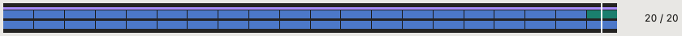

| State | Colour | Means |
|---|---|---|
| selected | blue | a label is wanted, and not finished yet. Every image starts here. |
| corrected | green | the label has been proofread. No automated operation will overwrite it. |
| deselected | grey | no label is wanted. |

To change a state, use the **State** tab on the right:

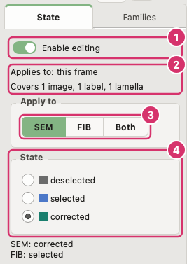

1. Switch on **Enable editing**. Nothing on Curate changes a file until you do.
2. Choose what to change. By default it is the frame on screen. To change more,
   **Ctrl-click** frames on the timeline (⌘-click on a Mac; **Shift-click**
   extends a run), or tick
   projects or lamellae in the lists. *Applies to* and *Covers* say how much you
   have chosen. A ticked project or lamella covers only the series chosen under
   **Series**; a lamella holding none of it is left out, and *Covers* says how
   many were.
3. Choose the beam: **SEM**, **FIB** or **Both**.
4. Choose the state. Larger changes ask before they are made.

Imaging conditions that share a label change state together, as they are one
segmentation. [Background](background.md#families-of-imaging-conditions) explains
how am-seg decides which conditions share a label, and how to correct it on
the **Families** tab.

### Predict and convert labels

*Operations on this frame* (8) act on the same choice as the state buttons,
and also wait for *Enable editing*. Each shows what it would do before doing it.

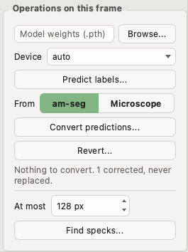

- **Predict labels...** runs a trained model over the chosen images. Choose the
  model's weights file with **Browse...**, and leave **Device** on *auto* to use
  the GPU with the most memory free. Predictions are kept apart from labels, so
  they never replace one. Predicting needs the `ml` extra installed.
- **Convert predictions...** turns predictions into labels for you to proofread.
  **From** chooses between am-seg's predictions and those the microscope made
  while milling. A corrected label is never replaced. Where a label is
  already there it asks first, counting what replacing comes to: an empty
  placeholder loses nothing; a label you edited but did not mark corrected is
  replaced, and kept under `AM_archive/` so **Revert...** or *Compare
  versions* can put it back; an earlier conversion nobody edited is not kept,
  since converting its prediction makes it again.
- **Revert...** puts labels back to what they held before the last conversion
  or merge, or at a savepoint.

The models Adaptive Milling was trained with are published on Zenodo
([doi:10.5281/zenodo.21804785](https://doi.org/10.5281/zenodo.21804785)).
`AM_SEM_All_V01.pth` was trained on all the data.

## 5. Proofread on the Label tab

The **Label** tab shows the lamella chosen on Curate at full resolution, for you
to correct its labels. It visits only the frames still worth proofreading.

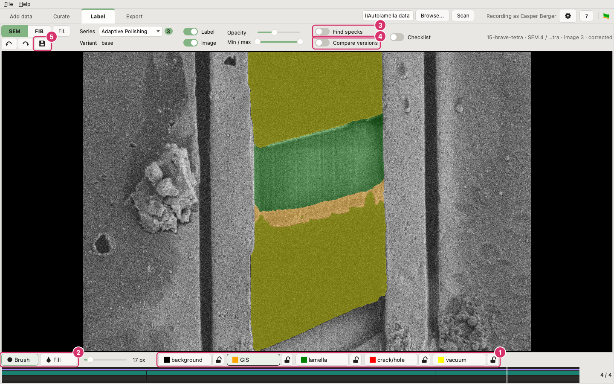

1. **Choose a class** to paint with, or **Shift-click** the label where it
   shows the class you want. The padlock beside a class locks it, so nothing
   paints over it.
2. **Brush** paints where you drag; **Fill** floods the area you click in.
   Scroll to zoom, and hold Space to pan.
3. **Find specks** rings every piece of a class too small to be likely real,
   such as a slip of the brush. It removes nothing; you decide what to paint
   over.

   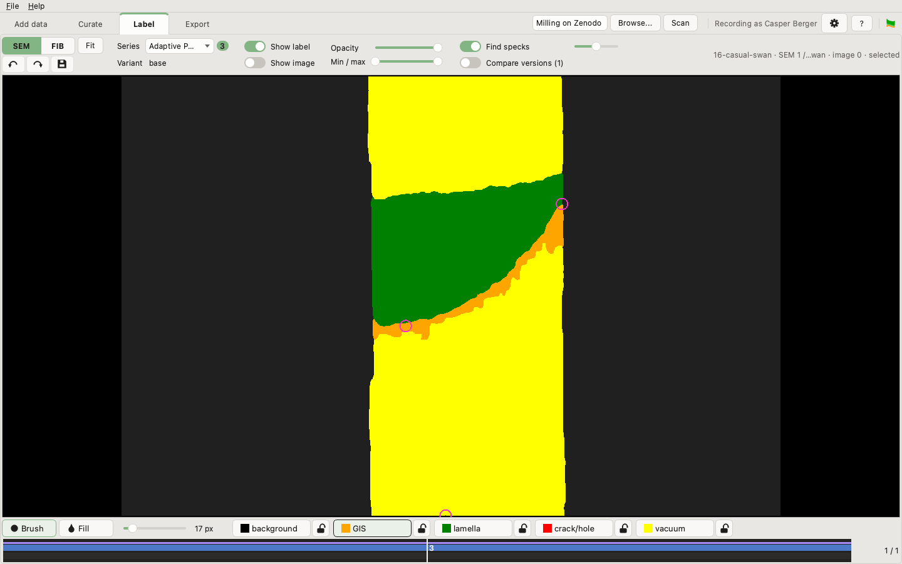

4. **Compare versions** lists the earlier versions of this label, and the
   predictions for this image, so you can flick between them (hold **B**) or
   restore one. While you have unsaved edits it starts on the label as saved,
   so **B** shows what your edits changed; otherwise on the label's most recent
   earlier version, even when a prediction is newer. A prediction is shown as
   the label converting it would write.
5. **Save** writes your edits. Until then they are held in the window. With
   *Enable editing* on, on Curate, **Save and mark corrected** also marks the
   frames you reviewed as corrected.

### Follow the checklist

Switch on **Checklist**, or press **C**, to list the steps of proofreading a
label beside the image. Press **C** to tick the step you are on and move to the
next, and **Shift+C** to go back. Select a step to read what to do in it;
**How to do this step...** explains how, with an example before and after.
Each label keeps its own progress while the window is open. A label ticked
through to the last step counts as checked, so saving can mark it corrected
even if it needed no change.

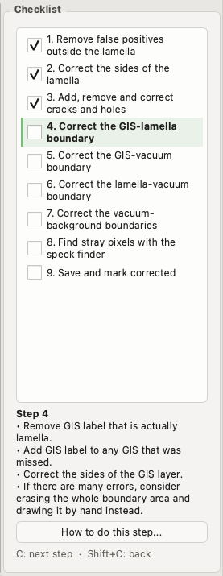

## 6. Export

The **Export** tab chooses a subset of your collection, counts it, and writes it
out. Its count is always what an export would cover.


1. **Filters** choose the images: by series, project, beam, state and label.
   **Add filter** filters on anything else, such as the microscope or the sample.
2. **Breakdown** counts them by one property, or by two against each other.
   Switch to **Chart** to draw the counts:

   

3. **Measure labels** reads every label and adds breakdowns of what they hold:
   the area of each class in µm², and the number of cracks.
4. **Training split** sets how the training set is divided. *Keep together*
   keeps each lamella on one side of the split by default, as successive images
   of one lamella are near-duplicates.
   *Validate on corrected only* scores on proofread labels alone while training
   on everything the filters match; with the state filter on *corrected +
   selected* that is proofread and predicted labels together. *Validation
   from...* keeps to an earlier export's split, so each round of training is
   scored on the same lamellae. *Balance by* gives validation its share of
   each kind of lamella, microscope or voltage. Set **Breakdown** to *training split* to count
   what each side holds, by microscope or kind of lamella.
5. **Write CSVs**: **Training CSV...** writes the image and label paths of a
   training set. The two metadata CSVs write one row per image or per project,
   for depositing the data.
6. **Copy out and merge back**: **Export images and labels...** copies the files
   into a folder of their own, to work on elsewhere. **Merge a copy back...**
   brings that work home again.

An empty label is never exported as a training pair: it would teach a model
that nothing is there.

## 7. Train a model

The **Train** tab trains a model on a training set you exported, with
[AM-model-training](https://github.com/rosalindfranklininstitute/AM-model-training),
the software the Adaptive Milling models were trained with. It needs the
`train` extra ([README](../README.md#installation)) and, to be practical, an
NVIDIA GPU: on a CPU, Apple silicon included, a step takes minutes per image.

In **New run**, under the list of runs, set the run up:

1. **Training set**: the one you last wrote with **Training CSV...** is offered,
   or **Browse...** to the `<name>_manifest.yaml` of an earlier one. The
   collection it was exported from is the folder you scanned, or where none
   is scanned, wherever the manifest says it is from its own folder. The split
   is the export's, so what is validated on is what **Keep together** set there.
2. **New model** or **Refine a model**. Refining starts from weights you choose
   and needs far less data and time. Each opens on the settings the Adaptive
   Milling models were published with, or on your own once you set them in
   *Settings* (F2), a box for each of the two. **Advanced settings** shows
   them; **My defaults** there puts back yours and **Recommended** the
   published ones. The seed here fixes augmentation and shuffling during
   training, and is not the seed an export shuffles its split with. Lower **Training batch**, to 1 if
   need be, where the GPU runs out of memory.
3. **Name** the run, and choose the **Device**.
4. **Start...** opens every label again, says what will be done, and asks. A
   label that is empty, will not open, or holds a class the model does not
   predict stops the run before anything is written.

Training runs on its own and goes on after you close the window. Several runs
can train at once: **Start...** says when one already is, and with two on
*auto* it is safer to name each a GPU, since a run started moments ago has
taken little memory yet. Above the form,
**Runs** lists every run in the training directory, which you choose once with
**Browse...** beside *Training directory* at the top of the column; keep it
outside your collection. The mark before a run says how it stands — not
started, training, finished, stopped by you, interrupted or failed — and F1
shows each mark. A run can finish before its last epoch: training ends early
once it has stopped improving. Each run has a column for the epochs trained of
the most it may train, with how far a validation has got while one is scoring,
its best epoch and that epoch's score, and the epoch you marked. The score is
what the run ranks its epochs by: the mean of the weighted-average IoU and
Dice on its validation list, from 0 to 1. Hover a heading for what it holds. Runs kept in a
folder of that directory are gathered under it, and **Expand** and **Collapse**
open and close every folder. Right-click a run to copy its path or reveal it in
the file manager. The tick boxes, with **Tick all** and **None**, choose the
runs **Table** sets side by side. **Weights** counts the weights a run saved
that are still on disk, of those it saved, which is where to look for runs to
tidy. Hover a run for the disk space they take, and for what the columns leave out:
which GPU a run in training is on, why one failed, who marked its best epoch,
how each validation of it stands, how many images it trains and validates on,
and the settings it was started with. While
a validation is scoring, the run's state says how many epochs it has scored.
A run that failed says so in red.
F1 says what the colours mean. A run
AM-model-training was started on directly, here or on another machine, is
listed too, from the files it wrote: point *Training directory* at the
folder holding such runs.

The tab is in three boxes: **Runs**, with what is done to the run selected
under the list; **Curves and table**; and **Checkpoints**, each listed by its
epoch. For the run selected, the tab shows its loss and a metric per
class by epoch, and its checkpoints. Switch a class off beside **Metric** to
take its curve out, and **background** or **vacuum** on to draw it, both left
out at first, each switch in the colour of its curve; the weighted averages stay over every class. The epochs
the encoder was frozen for are shaded grey behind the curves. Point at a
curve to read its class, epoch and value. Scroll over a chart to zoom about
the pointer, hold Space and drag to pan, and **Reset view**, or G, to undo
both; the wheel never zooms out beyond that view. **Reset view** is under the
chart, beside the buttons that save and copy it. The charts on Export answer
to the same.

- **Save a copy...** copies the selected epoch's weights to wherever you keep
  your models. To predict with it, choose that file as the model on Curate.
- **Mark as best...** counts the selected epoch as the run's best where the
  one the run chose is not the model you want; with none selected it asks
  which epoch, so a run whose weights are elsewhere can be marked too. A
  hollow star marks the run's own best and a filled one yours, and the curves
  mark both. **Clear best** takes it back.
- **Delete the others...** deletes that run's checkpoints except the ones you
  selected, about 170 MB each. It asks first and cannot be undone. The epoch
  you marked as best is always kept, and the run's own best too while **Keep
  the run's best** is switched on. Nothing is deleted while the run is training or
  being validated.
- **Stop** ends a run, which can take up to a minute. The epoch in progress is
  lost, and a stopped run is not continued: start another, refining from one
  of its checkpoints.

**Table**, beside **Curves**, compares the ticked runs: a row per run and a
block per class, shaded by value, for the metric and the classes chosen
above it. The slider beside **Colours** sets the two values the shading runs
between, a handle for each with the number at its end, and the bar beside the
table shows them. With **Auto** on, as it is at first, they are the lowest and
highest value in the table and follow it as runs are ticked and classes
switched; moving a handle switches it off, and switching it on fits them
again. The arrow keys step a handle by 0.01, and a double click puts it back.
**Each cell** is the value at the run's best epoch, at the epoch you
marked as best (the run's own where none is marked), or the mean or median
over the epochs you set, 60 to 90 at first; a refined model, which trains for
fewer, needs an earlier range. Beside each run are the epochs its values are
from, and a cell with nothing validated is grey. **Table as CSV...**
writes the numbers, and **Save figure...** the table.

**Validate...** scores the selected run's checkpoints on another training
export: its validation list, or every row of an export made of data the run
never trained on. Each checkpoint on disk is run over each image once, in the
background like a training run, and what it scored on every image is kept in
the run's folder; the run's state says how far a validation has got while it scores,
and **Stop validating** ends one, keeping the epochs it finished. It needs the
`train` extra and, in practice, a GPU.

**Validated on** then chooses what the validation side of the curves and the
table is of: the list each run validated on as it trained, one of those
validations, or every set side by side. **Split by** divides a validation by
what the export recorded of its images, such as the instrument, the voltage or
the kind of lamella: the curves show the one part chosen beside it, and the
table gives each part a column under every class, with a tick box to leave one
out. The best and the marked epoch stay the ones chosen on the run's own list,
so the table says how the model you would use does on each part. A training
export made before the images file was written has nothing to split by.

The same can be done with `am-seg train`, `show-training`, `validate`, `compare-training`, `choose-best` and `stop-training`
([Train](command_line.md#train)).

## Undo and history

am-seg keeps a record of every change, and a copy of every label it replaces,
inside each project. To undo work:

- **Revert...**, on Curate, puts the chosen labels back to before the last
  conversion or merge.
- **Compare versions**, on Label, restores any earlier version of one label.
- **Savepoint...**, in the *Maintenance* card on Add data, names the state of
  every label, so you can return to it later.

[Background](background.md#history) explains what is recorded, savepoints, and
working on a copy.
